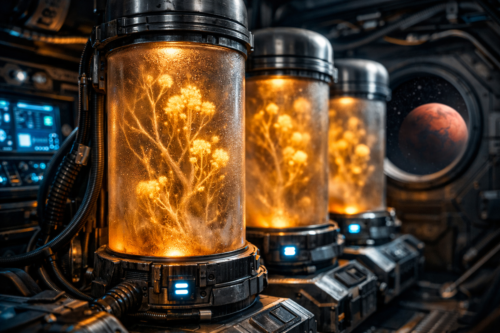

 

<a href="https://sosofisouza.github.io/global-solution-eva/site/">Ver o site</a>
&nbsp;&nbsp;·&nbsp;&nbsp;
<a href="https://wokwi.com/projects/465809120774624257">Simular a telemetria no Wokwi</a>

 

### Sobre o projeto

A **E.V.A.** une fungos micorrízicos, sensores IoT e inteligência artificial para **regenerar solos degradados na Terra** e **viabilizar a colonização sustentável de Marte**. O projeto venceu a **Global Solution 2026 da FIAP**, com o tema "Indústria Espacial: O Código que Move o Universo".

 

  

 

### O que tem neste repositório

| Pasta | Disciplina | O que é |
|:---|:---|:---|
| [`site/`](./site) | Front-End | Site da E.V.A. em 5 páginas, com parallax, terminal ao vivo e gráfico de métricas |
| [`edge-computing/`](./edge-computing) | Edge Computing | Telemetria da cápsula SpaceX Dragon que leva os fungos até Marte, com ESP32, 6 sensores, alertas locais, MQTT e Node-RED |

Cada pasta tem o próprio README com os detalhes e como executar.

 

### Tecnologias

  
   
  HTML5 · CSS3 · JavaScript · Bootstrap · Chart.js · ESP32 · C++ · MQTT · HiveMQ · Node-RED · Wokwi

 

### Equipe

Camile Silva &nbsp;·&nbsp; Gustavo Ferreira &nbsp;·&nbsp; Lucas Caetano &nbsp;·&nbsp; Marco Conte &nbsp;·&nbsp; Sofia Rodrigues

