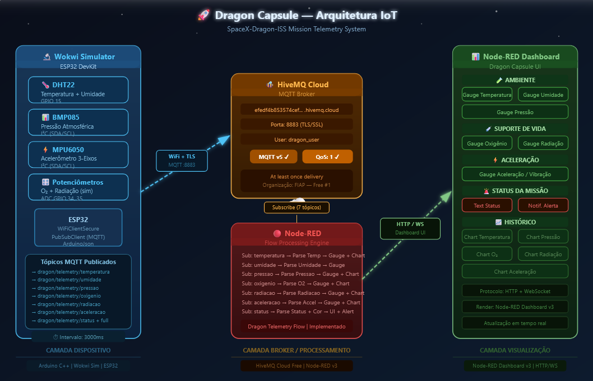
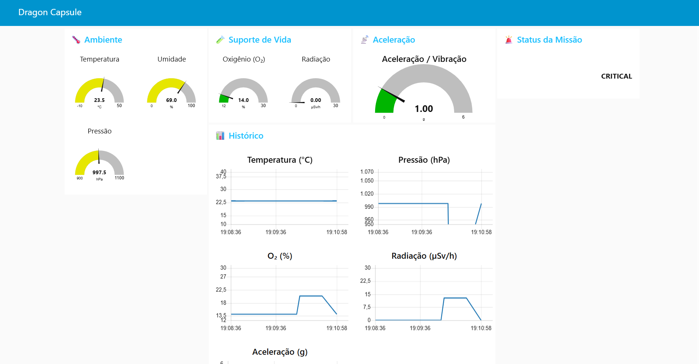

 

<a href="https://sosofisouza.github.io/global-solution-eva/site/">Ver o site</a>
&nbsp;&nbsp;·&nbsp;&nbsp;
<a href="https://wokwi.com/projects/465809120774624257">Simular a telemetria no Wokwi</a>

 

### Sobre o projeto

A **E.V.A. (Ecossistema Vivo Adaptável)** é um sistema biointeligente que une **fungos micorrízicos, sensores IoT e inteligência artificial** para criar ambientes capazes de sustentar vida em condições extremas. A mesma solução atende dois cenários: **regenerar solos degradados na Terra** e **transformar o regolito de Marte em solo cultivável**.

O projeto foi desenvolvido na **Global Solution 2026** do 1º ano de Engenharia de Software da FIAP, com o tema **"Indústria Espacial: O Código que Move o Universo"**, e foi o **projeto vencedor**.

 

### O desafio

Na Global Solution, cada equipe atua como uma empresa de engenharia de software contratada para conceber, arquitetar e prototipar uma solução real conectada à indústria espacial. O projeto é único por equipe, e cada disciplina do semestre entrega uma camada dele: pitch, documentação de software, protótipo em Python, site, aplicação em React, sistema embarcado e estudo matemático.

Nossa leitura do tema: o espaço é o ambiente mais restritivo que existe, e uma solução que funciona em Marte também resolve problemas na Terra.

 

### O problema

| Na Terra | Em Marte |
|:---|:---|
| Solos férteis degradados por agricultura intensiva e uso excessivo de pesticidas | Regolito com alta concentração de percloratos, tóxicos para a vida |
| Perda de biodiversidade e colapso de ecossistemas | Radiação cósmica e UV intensas, sem atmosfera ou campo magnético que protejam |
| Desertificação e queda da capacidade produtiva agrícola | Ausência de nutrientes orgânicos e de estrutura que sustente vida |
| Contaminação por metais pesados e resíduos industriais | Variações diárias de temperatura de até 100 °C |

 

### A solução

A E.V.A. funciona em três camadas integradas, dentro de um **Dome inteligente**:

**1. Rede fúngica (biologia aplicada).** Cada espécie de fungo tem uma função:

| Fungo | Função |
|:---|:---|
| *Trichoderma* spp. | Absorve e metaboliza percloratos e estabiliza o pH do solo |
| *Pleurotus ostreatus* | Forma uma rede de micélio que une as partículas do regolito e retém água |
| *Glomus* e *Rhizophagus* | Fazem simbiose com as raízes das plantas e trocam nutrientes por carbono |
| *Cladosporium sphaerospermum* | Fungo radiotrófico, encontrado em Chernobyl, que converte radiação em energia e funciona como blindagem biológica |

**2. Sensores IoT.** 24 sensores distribuídos no Dome medem pH, umidade, radiação, temperatura, toxicidade e atividade bioelétrica do micélio, e enviam os dados via MQTT.

**3. IA Sentinel.** Agente que recebe os dados dos sensores e decide sozinho como ajustar o sistema: liberação de enzimas, irrigação e temperatura. Foi pensado para análise preditiva (antecipar desequilíbrios), detecção de anomalias (separar falha de sensor de evento real) e operação autônoma, necessária em Marte, onde a comunicação com a Terra tem até 24 minutos de atraso.

 

### Fases da missão

  

 

| Fase | Etapa | Duração | O que acontece |
|:---:|:---|:---|:---|
| 0 | Transporte da carga biológica | 7 meses, Terra a Marte | Os fungos viajam em câmaras criogênicas na cápsula SpaceX Dragon, com telemetria IoT em tempo real |
| 1 | Desintoxicação | 0 a 5 dias | *Trichoderma* e bactérias extremófilas reduzem a toxicidade e estabilizam o pH entre 6,5 e 7,2 |
| 2 | Estruturação do solo | 5 a 15 dias | O micélio de *Pleurotus* cria uma estrutura porosa que retém água e deixa o ar circular |
| 3 | Nutrição e regeneração | 15 a 30 dias | Fungos micorrízicos se conectam às plantas pioneiras e iniciam um ciclo de nutrientes autossustentável |
| 4 | Proteção e estabilidade | 30 dias em diante | Fungos radiotróficos formam uma camada viva de proteção contra radiação |

 

**Metas projetadas pela equipe**

| Indicador | Antes | Depois |
|:---|:---:|:---:|
| Toxicidade de perclorato | 140 ppm | 17 ppm (redução de 87% em 120 h) |
| Retenção de água no solo | 18% | 68% (aumento de 340%) |
| pH do solo | 4,1 (ácido) | 7,1 (neutro) |
| Área de absorção das raízes | base | até 10 vezes maior |
| Produção de alimentos | 0 kg/m² | 2,4 kg/m² por mês |

 

### Impacto

**Na Terra:** recuperação de solos degradados sem químicos, menor necessidade de irrigação, descontaminação de áreas de mineração e indústria, retorno da biodiversidade e segurança alimentar em regiões em desertificação.

**Em Marte:** produção local de alimentos, sem depender de cargas enviadas da Terra (cerca de US$ 10 mil por quilo), proteção radiológica biológica e operação autônoma do ecossistema.

**Objetivos de Desenvolvimento Sustentável da ONU:** ODS 2 (Fome Zero), ODS 9 (Indústria, Inovação e Infraestrutura) e ODS 13 (Ação Climática).

 

### O que tem neste repositório

| Pasta | Disciplina | O que é |
|:---|:---|:---|
| [`site/`](./site) | Front-End Design | Site da E.V.A. em 5 páginas (Problema, Tecnologia, Objetivos, Benefícios e Aplicação), com dashboard de sensores, terminal da IA Sentinel e gráfico de métricas em Chart.js |
| [`edge-computing/`](./edge-computing) | Edge Computing & Computer Systems | Telemetria da Fase 0: ESP32 monitora a cápsula Dragon que leva os fungos até Marte |

Cada pasta tem o próprio README com os detalhes e como executar.

 

### Telemetria da cápsula Dragon

Antes de qualquer fungo atuar no solo marciano, ele precisa chegar vivo. O ESP32 lê 6 parâmetros a cada 3 segundos, publica os dados via MQTT no HiveMQ Cloud e aciona LEDs e buzzer quando algum valor sai da faixa segura. O Node-RED recebe as mensagens e exibe o dashboard em tempo real e o histórico.

| Parâmetro | Faixa segura |
|:---|:---:|
| Temperatura | 4 a 25 °C |
| Umidade | acima de 30% |
| Pressão | 0,9 a 1,1 atm |
| Radiação | abaixo de 10 µSv/h |
| Oxigênio | acima de 19,5% |
| Aceleração | abaixo de 2 G |

  
    
  

 

### Tecnologias

  
   
  HTML5 · CSS3 · JavaScript · Bootstrap · Chart.js · ESP32 · C++ · MQTT · HiveMQ · Node-RED · Wokwi

 

### Equipe

Camile Silva &nbsp;·&nbsp; Gustavo Ferreira &nbsp;·&nbsp; Lucas Caetano &nbsp;·&nbsp; Marco Conte &nbsp;·&nbsp; Sofia Rodrigues

