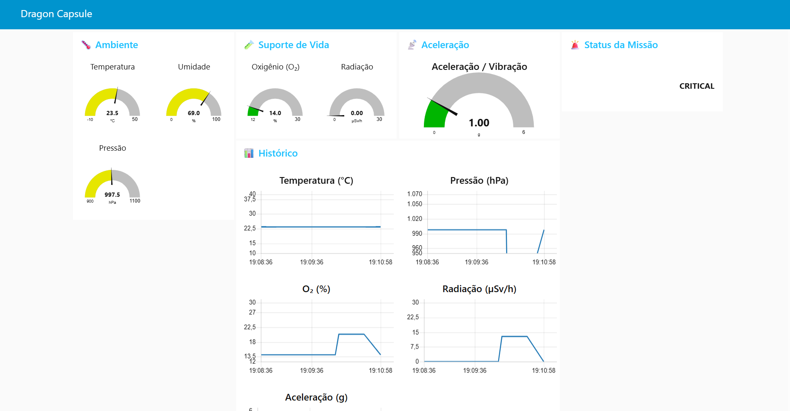
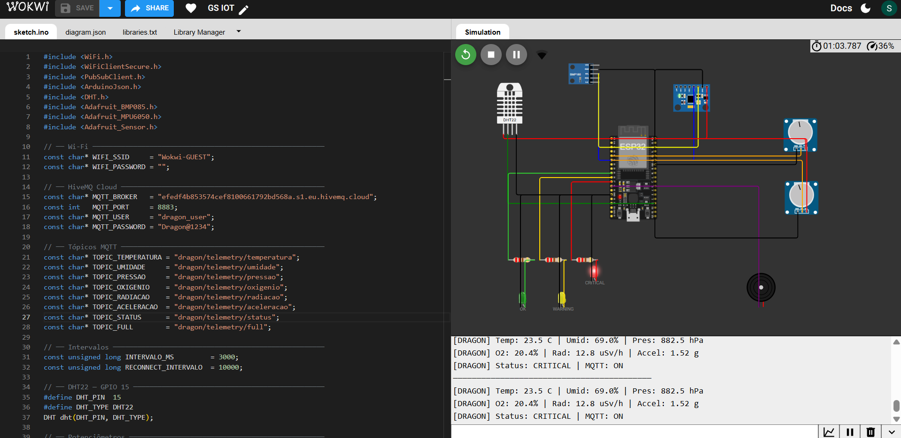

<div align="center">


<br>

<a href="https://wokwi.com/projects/465809120774624257">Simular no Wokwi</a>

</div>

<br>

### Sobre o projeto

Parte de Edge Computing da **E.V.A.**, projeto vencedor da **Global Solution 2026 da FIAP**. A E.V.A. usa fungos para regenerar solos, na Terra e em Marte, e antes de chegar a Marte os fungos precisam sobreviver a cerca de 7 meses de viagem.

Este sistema monitora o ambiente da cápsula **SpaceX Dragon** durante o transporte: um **ESP32** lê 6 sensores a cada 3 segundos, avalia os riscos localmente e envia tudo por **MQTT com TLS**. O **Node-RED** recebe os dados e mostra um dashboard para a equipe em Terra.

<br>

<div align="center">
  
  &nbsp;
  
</div>

<br>

### Arquitetura

```
Cápsula Dragon (ESP32 + sensores)  ── MQTT/TLS ──►  HiveMQ Cloud  ──►  Node-RED  ──►  Dashboard
  decide o alerta localmente
```

Mais detalhes no [diagrama de blocos](./docs/diagrama-de-blocos.png) e no [fluxograma](./docs/fluxograma.png).

<br>

### Sensores

| Sensor | O que mede |
|:---|:---|
| DHT22 | Temperatura e umidade |
| BMP180 | Pressão atmosférica |
| MPU-6050 | Aceleração nos 3 eixos |
| Potenciômetro (GPIO 34) | Oxigênio |
| Potenciômetro (GPIO 35) | Radiação |

<br>

### Sistema de alertas

O ESP32 decide o nível de alerta sozinho, mesmo sem conexão com o broker.

| Nível | Sinal | O que acontece |
|:---|:---|:---|
| 0 · Nominal | LED verde | Tudo dentro dos limites |
| 1 · Atenção | LED amarelo | Algum parâmetro perto do limite |
| 2 · Crítico | LED vermelho e buzzer | Algum parâmetro fora do limite |

<details>
<summary><b>Ver os limites de cada parâmetro</b></summary>
<br>

| Parâmetro | Nominal | Atenção | Crítico |
|:---|:---|:---|:---|
| Temperatura | 17 a 27 °C | 10 a 17 °C ou 27 a 35 °C | abaixo de 10 °C ou acima de 35 °C |
| Umidade | 25 a 70 % | abaixo de 25 % ou acima de 70 % | — |
| Pressão | 980 a 1040 hPa | 950 a 980 ou 1040 a 1070 hPa | abaixo de 950 ou acima de 1070 hPa |
| Oxigênio | 18 a 24 % | 16 a 18 % ou 24 a 26 % | abaixo de 16 % ou acima de 26 % |
| Radiação | abaixo de 5 µSv/h | 5 a 20 µSv/h | acima de 20 µSv/h |
| Aceleração | abaixo de 2,5 G | 2,5 a 4,5 G | acima de 4,5 G |

</details>

<br>

### Tópicos MQTT

| Tópico | Conteúdo |
|:---|:---|
| `dragon/telemetry/temperatura`, `umidade`, `pressao`, `oxigenio`, `radiacao`, `aceleracao` | Uma leitura por tópico |
| `dragon/telemetry/status` | Nível de alerta atual |
| `dragon/telemetry/full` | Todos os dados em um único JSON |

<br>

### Tecnologias

<div align="center">
  
  <br>
  <sub>ESP32 · C++ · MQTT · HiveMQ Cloud · Node-RED · Wokwi</sub>
</div>

<br>

### Como executar

1. Abra o [projeto no Wokwi](https://wokwi.com/projects/465809120774624257).
2. No `sketch.ino`, troque `SEU_USUARIO_MQTT` e `SUA_SENHA_MQTT` pelas credenciais do seu broker.
3. Clique em *Start Simulation* e gire os potenciômetros para simular mudanças de oxigênio e radiação.
4. No Node-RED, importe o `flows.json` e configure o broker para ver o dashboard.

<br>

### Mais da E.V.A.

- [Site da E.V.A.](../site)

<br>

### Equipe

<div align="center">

Camile Silva &nbsp;·&nbsp; Gustavo Ferreira &nbsp;·&nbsp; Lucas Caetano &nbsp;·&nbsp; Marco Conte &nbsp;·&nbsp; Sofia Rodrigues

</div>


