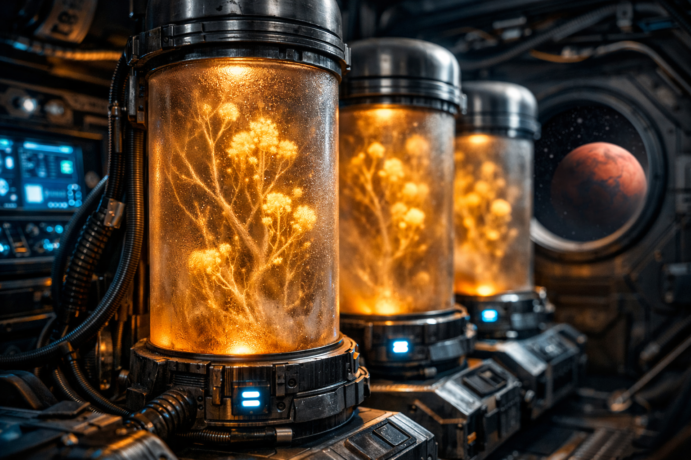

 

<a href="https://sosofisouza.github.io/global-solution-eva/site/">Ver o site</a>

 

### Sobre o projeto

Site da **E.V.A.**, projeto vencedor da **Global Solution 2026 da FIAP**. A E.V.A. une fungos micorrízicos, sensores IoT e inteligência artificial para **regenerar solos degradados na Terra** e **viabilizar a colonização sustentável de Marte**.

 

  

 

### Páginas

| Página | Conteúdo |
|:---|:---|
| Início | O problema |
| Tecnologia | Como a E.V.A. funciona |
| Objetivos | As fases do projeto, expansíveis |
| Benefícios | O impacto na Terra e em Marte |
| Aplicação | Missão ao vivo, dashboard de sensores e equipe |

 

### Destaques

- Efeito parallax, terminal ao vivo e contador animado
- Gráfico de métricas com Chart.js
- Layout responsivo para computador, tablet e celular
- Cores, fontes e espaçamentos organizados em variáveis CSS

 

### Tecnologias

  
   
  HTML5 · CSS3 · JavaScript · Bootstrap 5 · Chart.js · Google Fonts

 

### Como executar

Abra o `index.html` no navegador. Não precisa instalar nada.

 

### Mais da E.V.A.

- [Telemetria da cápsula (Edge Computing)](../edge-computing)

 

### Equipe

Camile Silva &nbsp;·&nbsp; Gustavo Ferreira &nbsp;·&nbsp; Lucas Caetano &nbsp;·&nbsp; Marco Conte &nbsp;·&nbsp; Sofia Rodrigues

